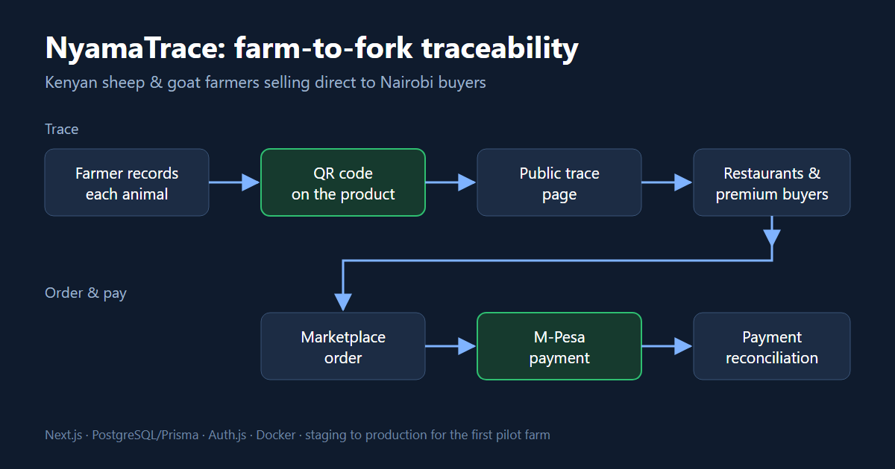

### Hi, I'm Denis 👋

I'm a CTO who still ships code. I look after architecture, hosting, security and
payments for early-stage startups and social-impact organisations in Kenya, from the
strategy conversation down to the pull request.

- **CTO at Digital Chances**, a Kenyan technology and social-impact organisation.
- **Founder of scalA (Scale a Life!)**, a community organisation run by and for young
  people leaving care, with its own giving platform.
- I run a production VPS with dozens of containers and public sites for several
  organisations, and I led its security hardening.
- My degree is in business and commerce, so I build payment features with the books
  in mind: reconciliation, audit trails, no double payments.

**Stack:** Next.js / React · Node.js · TypeScript · PostgreSQL / Prisma · MongoDB ·
Frappe / ERPNext · Docker · Nginx / Caddy · M-Pesa (Daraja), Paystack, card and bank
payments.

### Live projects

#### scalA

[scalA (Scale a Life!)](https://scala.co.ke) raises funds for young people leaving care in
Kenya. I founded it and lead its technology:

- Guest checkout (give without an account) and KES payments via Paystack, M-Pesa, card
  and bank transfer.
- Member KYC with consent-gated publishing of personal stories.
- Google Ad Grants re-application in one week: PageSpeed 100, a full rebrand to a new
  design system, and accessibility fixes.
- Stack: Next.js 16, Frappe v15, Docker, Nginx.

#### NyamaTrace

[NyamaTrace](https://nyamatrace.digitalchances.cloud) is a farm-to-fork traceability app
and marketplace for Kenyan sheep and goat farmers. I'm its designer and admin, and I took
it from staging to production for its first pilot farm:

- Farmers record each animal; buyers scan a QR code that opens a public trace page showing
  where their meat came from.
- Orders paid with M-Pesa, with a reconciliation step so payments match orders.
- Stack: Next.js, React, PostgreSQL / Prisma, Auth.js, Docker.

The code for both projects is private; the sites are live.

### Public examples

Most of my work lives in private repositories that belong to the organisations I work
with. These are small, self-contained examples of how I approach the same problems:

| Repository | What it shows |
| --- | --- |
| [mpesa-daraja-reconciliation](https://github.com/DenisIreri/mpesa-daraja-reconciliation) | M-Pesa STK Push with idempotent callbacks and a reconciliation report: duplicates, wrong amounts, double payments and lost callbacks are caught, not ignored. |
| [docker-vps-hardening](https://github.com/DenisIreri/docker-vps-hardening) | A baseline for running several apps on one Docker host without exposing databases or admin panels, including the Docker/UFW firewall gap most setups miss. |

### Work with me

I take on fractional CTO and senior engineering work: technical leadership without a
full-time hire. You can find me on Upwork as a Fractional CTO.
