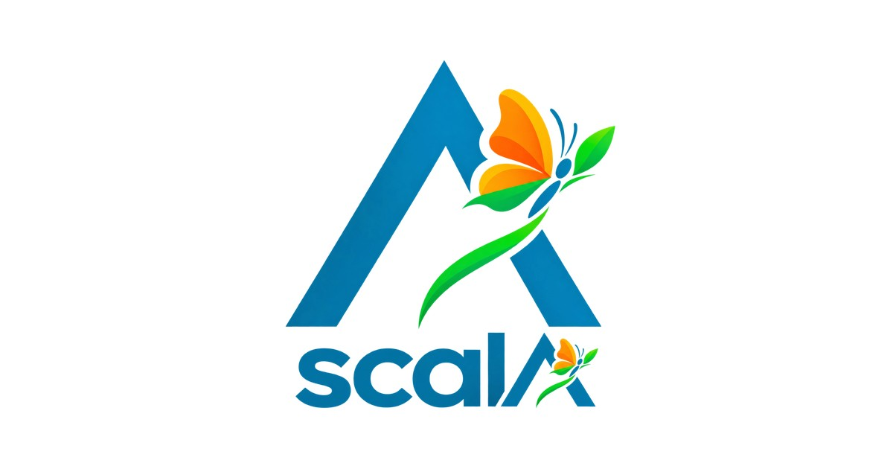
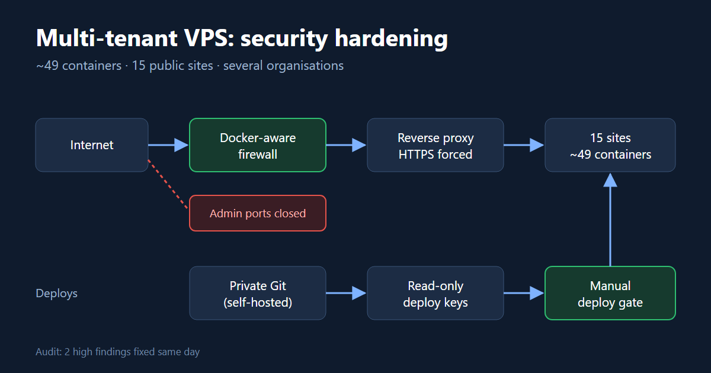
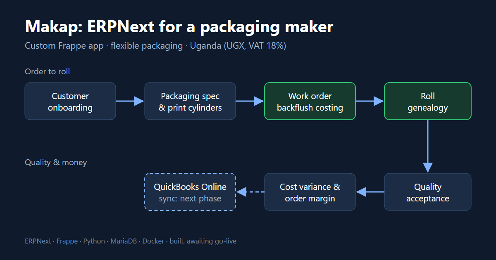
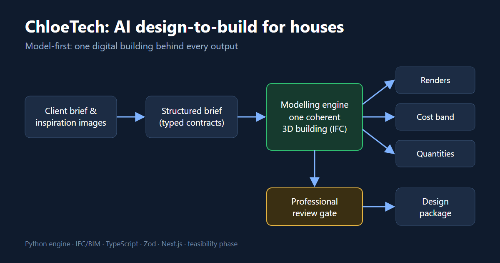

### Hi, I'm Denis 👋

I'm a CTO who still ships code. I look after architecture, hosting, security and
payments for early-stage startups and social-impact organisations in Kenya, from the
strategy conversation down to the pull request.

- **CTO at Digital Chances**, a Kenyan technology and social-impact organisation.
- **Founder of scalA (Scale a Life!)**, a community organisation run by and for young
  people leaving care, with its own giving platform.
- I run a production VPS with dozens of containers and public sites for several
  organisations, and I led its security hardening.
- My degree is in business and commerce, so I build payment features with the books
  in mind: reconciliation, audit trails, no double payments.

**Stack:** Next.js / React · Node.js · TypeScript · PostgreSQL / Prisma · MongoDB ·
Frappe / ERPNext · Docker · Nginx / Caddy · M-Pesa (Daraja), Paystack, card and bank
payments.

### Live projects

#### scalA

[scalA (Scale a Life!)](https://scala.co.ke) raises funds for young people leaving care in
Kenya. I founded it and lead its technology:

- Guest checkout (give without an account) and KES payments via Paystack, M-Pesa, card
  and bank transfer.
- Member KYC with consent-gated publishing of personal stories.
- Google Ad Grants re-application in one week: PageSpeed 100, a full rebrand to a new
  design system, and accessibility fixes.
- Stack: Next.js 16, Frappe v15, Docker, Nginx.

#### NyamaTrace

[NyamaTrace](https://nyamatrace.digitalchances.cloud) is a farm-to-fork traceability app
and marketplace for Kenyan sheep and goat farmers. I'm its designer and admin, and I took
it from staging to production for its first pilot farm:

- Farmers record each animal; buyers scan a QR code that opens a public trace page showing
  where their meat came from.
- Orders paid with M-Pesa, with a reconciliation step so payments match orders.
- Stack: Next.js, React, PostgreSQL / Prisma, Auth.js, Docker.

#### Multi-tenant VPS: security hardening

One VPS hosts about 49 containers and 15 public sites for several organisations. As CTO
at Digital Chances I commissioned and approved its security hardening:

- Exposed admin ports closed, and a firewall layer Docker cannot bypass.
- A dead Cloudflare tunnel removed.
- Repositories moved from GitHub to private self-hosted Git, with read-only deploy keys
  and manual deploy gates.
- A follow-up audit found two high-severity issues; both were fixed the same day.

A generic version of the approach is public:
[docker-vps-hardening](https://github.com/DenisIreri/docker-vps-hardening).

The code for scalA and NyamaTrace is private; the sites are live.

### In progress

#### Makap: ERPNext for a packaging manufacturer (Uganda)

A custom ERPNext (Frappe) app for a flexible-packaging manufacturer, built and awaiting
go-live. I'm its architect and lead developer.

- Packaging specifications, material structures, print-cylinder ownership, customer
  onboarding and quality acceptance requirements.
- Roll genealogy traces every roll; work-order cost variance shows actual material use
  against plan; an order closure view shows margin.
- Company setup (UGX, VAT 18%, July–June year) runs as a dry run first.
- Next phase: a sync to QuickBooks Online, the client's accounting platform.
- Stack: ERPNext / Frappe, Python, MariaDB, Docker.

#### ChloeTech: AI design-to-build platform for houses

A platform that turns a client's brief and inspiration images into one coherent 3D house
design, a preliminary cost band and, after professional review, a design package. I'm its
architect and lead developer.

- Model-first: a single digital building model sits behind every output, and AI imagery
  is never treated as geometry.
- Built so far: shared Zod contracts, a Python modelling engine with an IFC (BIM) backend,
  and a feasibility test harness with 531 engine tests.
- Currently in its feasibility phase, before the client-facing web app.
- Stack: Python, IFC / BIM, TypeScript, Zod; Next.js planned for the web app.

Both repositories are private.

### Public examples

Most of my work lives in private repositories that belong to the organisations I work
with. These are small, self-contained examples of how I approach the same problems:

| Repository | What it shows |
| --- | --- |
| [mpesa-daraja-reconciliation](https://github.com/DenisIreri/mpesa-daraja-reconciliation) | M-Pesa STK Push with idempotent callbacks and a reconciliation report: duplicates, wrong amounts, double payments and lost callbacks are caught, not ignored. |
| [docker-vps-hardening](https://github.com/DenisIreri/docker-vps-hardening) | A baseline for running several apps on one Docker host without exposing databases or admin panels, including the Docker/UFW firewall gap most setups miss. |

### Work with me

I take on fractional CTO and senior engineering work: technical leadership without a
full-time hire. You can find me on Upwork as a Fractional CTO.
